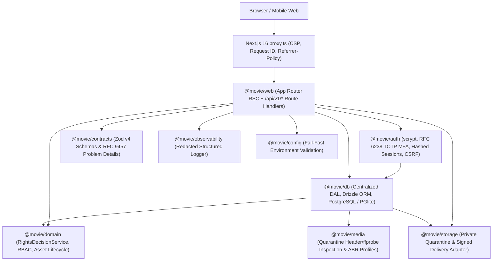

# Architecture Overview

## 1. Modular Monolith Topology

Cinematic Graphite is structured as a modular monolith inside a `pnpm` workspace so domain invariants, type safety, and security boundaries remain centralized without premature microservice sprawl:

## 2. Key Architectural Decisions

1. **Next.js 16 Cache Components (`cacheComponents: true`)**: Public shell Chrome and static legal/editorial frames prerender fast, while dynamic runtime inputs (`searchParams`, `cookies()`, `headers()`, uncached DB queries) resolve inside explicit `<Suspense>` boundaries. Personalized and rights-sensitive responses emit `Cache-Control: no-store` or `private, no-store`.
2. **Centralized Rights Policy (`@movie/domain`)**: `evaluateRights()` is a pure, deterministic policy engine tested independently from HTTP and database layers. All publish, stream, and download checks flow through this single gate.
3. **Private-Only Origin Storage (`@movie/storage`)**: Source masters, quarantine staging objects, and packaged segments use opaque non-PII keys (`<prefix>/<assetId>/<objectId>.<ext>`). Public viewers never receive bucket credentials or raw master keys; authorized delivery issues short-lived HMAC-signed URLs scoped to a single object.
4. **Archive vs. Hot Delivery Separation**: Consumer cloud drives (including Google Drive) are never used as public hot-delivery CDNs. Primary delivery uses S3-compatible object storage (e.g., Cloudflare R2) with an optional asynchronous archive backup connector for operator-owned cold copies.
