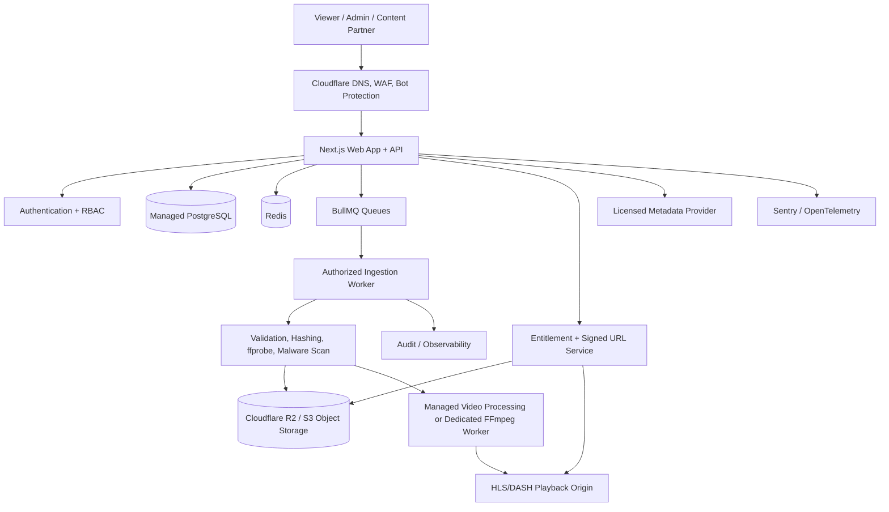

# Movie Discovery & Authorized Media Distribution Platform
## Production Blueprint + AI Coding-Agent Master Prompt

**Version:** 1.0  
**Prepared:** 6 November 2026  
**Project assumption:** This blueprint is for a lawful movie catalogue and media-distribution platform. It supports films that the operator owns, has licensed, or has individually verified as public-domain / appropriately Creative-Commons-licensed in the relevant territory. It is not a piracy-site scraper, mirror-leech bot, or copyright-evasion system.

---

# PART I — PRODUCT AND ENGINEERING BLUEPRINT

## 1. Executive direction

Build one platform with four integrated capabilities:

1. **Movie discovery:** browse, search, filter, view movie details, cast, genres, languages, release year, trailers, subtitles, and availability.
2. **Authorized watch/download:** stream or download a film only when an active rights record explicitly permits that action for the user's territory and the current date.
3. **Media library and ingestion:** ingest owner-supplied files, licensed distributor deliveries, or explicitly authorized source files; validate, fingerprint, process, store, and publish them.
4. **Operations console:** manage metadata, files, rights, storage, jobs, users, access, reports, takedowns, and audit logs.

### Non-negotiable product rule

A movie record is not proof that the platform has the right to distribute its video file. Metadata, artwork, trailers, subtitles, and the full audiovisual work can have different owners and different licenses. The platform must maintain a separate rights record for each relevant asset and use type.

**Publication gate:** no movie can become publicly streamable or downloadable unless an administrator has approved an active rights grant that covers the asset, territory, use type, and date range.

## 2. What the supplied conversation establishes

The initial concept described in the conversation is:

- A movie catalogue inspired by sites such as HDHub4u.
- Collecting movie metadata, posters, categories, and file availability.
- Automatically fetching files, moving them through a VPS, and uploading them to four separate Google accounts.
- A VPS currently described as 2 vCPU, 8 GB RAM, and 100 GB storage from boxd.sh.
- Four separate Google accounts, each described as having a 5 TB Google One plan.

The technical product goal can be preserved in a lawful implementation: one website, one backend, one job system, multiple storage destinations, and an admin interface. The acquisition mechanism must be changed to authorized uploads and licensed provider integrations, not unauthorized extraction from piracy sites or bypassing shortlink / anti-bot controls.

## 3. Scope: MVP versus later releases

### MVP — prove the complete legal workflow

- Public homepage with featured, recent, popular, and curated titles.
- Movie detail page with metadata, artwork, trailer, languages, subtitles, and availability.
- Search by title and filters for genre, year, language, country, and content type.
- User registration, login, watchlist, and download history.
- Admin CMS for movie metadata and people/genre relationships.
- Rights ledger and approval workflow.
- Direct owner upload to object storage using short-lived upload credentials.
- File validation, checksum, metadata probing, job queue, and processing status.
- Authorized streaming and/or download through expiring signed access.
- Admin job monitor, audit log, report/takedown intake, and basic analytics.

### Release 2 — operational maturity

- Partner/distributor API integrations.
- Bulk metadata import from licensed sources.
- Subtitle management and subtitle quality checks.
- Advanced search, recommendations, collections, and localization.
- Storage replication / backup policies and restore testing.
- Creator / distributor portal with scoped access.
- Subscription or payment entitlement only after legal rights and payment-provider policies are confirmed.

### Release 3 — scale

- Dedicated media-processing workers with autoscaling.
- Multi-region delivery and origin failover.
- Search engine such as Meilisearch or OpenSearch when PostgreSQL search is no longer sufficient.
- Recommendation pipeline based on privacy-conscious first-party events.
- Data warehouse / analytics pipeline.
- Multi-tenant partner management and detailed revenue reporting.

Do not start with microservices, Kubernetes, a custom CDN, or an elaborate recommendation model. A modular monolith plus background workers is simpler to build, secure, debug, and operate for the first release.

## 4. Recommended system architecture



### Architectural principles

- **Modular monolith first:** keep catalog, identity, rights, ingestion, storage, and downloads in clear modules in one deployable application.
- **Async for heavy work:** never transcode, scan, copy, or hash very large media files inside a normal web request.
- **Direct-to-object-storage uploads:** the browser uploads to R2/S3 using short-lived upload credentials; the VPS should not be the middleman for large media payloads.
- **Database is the source of truth:** the database stores metadata, permissions, lifecycle state, asset references, and checksums. The object store stores bytes.
- **Private by default:** source videos and originals are private. Public delivery happens only through an authorization check and a short-lived signed URL or playback token.
- **Idempotent jobs:** retrying a job must not create duplicate movie records, duplicate billing, or corrupt files.
- **Provider abstraction:** define a storage interface so the application can use R2, S3, or another S3-compatible provider without rewriting business logic.

## 5. Recommended technology stack

| Layer | Recommended choice | Reason / trade-off |
|---|---|---|
| Web application | Next.js App Router + React + TypeScript | Full-stack routing, server rendering, API route handlers, and a mature production ecosystem. |
| Styling / components | Tailwind CSS + shadcn/ui or Radix primitives | Consistent, accessible components with control over visual quality. |
| Backend structure | Next.js route handlers + modular service layer | Avoids premature microservices. Extract a separate API later only if justified. |
| Database | Managed PostgreSQL 18 (or provider-supported stable version) | Relational rights, asset, user, job, and catalogue data fit PostgreSQL well. |
| ORM | Prisma 7 stable or Drizzle | Pick one; avoid adopting a release candidate for the first production build. |
| Authentication | Auth.js or a managed provider such as Clerk | Use secure session handling, email verification, MFA for admins, and database-backed roles. |
| Queue / workers | Redis + BullMQ | Retries, delayed jobs, concurrency controls, and rate limiting. |
| Object storage | Cloudflare R2 or S3-compatible storage | Media objects, originals, subtitles, and thumbnails; R2 has no direct egress charge under its current pricing model. |
| Video processing | Cloudflare Stream for suitable 360p–1080p workflows; otherwise a managed transcoder or isolated FFmpeg workers | Keep encoding away from the small web VPS. Verify resolution, codec, DRM, and pricing requirements before committing. |
| Search | PostgreSQL full-text search initially | No extra service until relevance, scale, or language needs justify one. |
| CDN / edge security | Cloudflare DNS, WAF, rate limits, cache rules | Protect the app and accelerate static/media delivery. |
| Testing | Vitest + Playwright | Unit/integration tests plus browser-level end-to-end tests. |
| Monitoring | Sentry + structured logs + OpenTelemetry | Errors, traces, worker failures, and operational visibility. |
| CI/CD | GitHub Actions | Lint, typecheck, tests, dependency audit, build, and deployment. |

**Version discipline:** use current stable releases when implementation begins, pin exact versions in the lockfile, and do not let an AI agent silently upgrade major dependencies mid-task.

## 6. Storage and media-delivery strategy

### Recommended role for each service

| Service | Use it for | Do not use it for |
|---|---|---|
| Cloudflare R2 / S3 | Private originals, authorized downloadable files, subtitles, thumbnails, manifests, and backups | Database records or secrets. |
| Cloudflare Stream or another managed video platform | Adaptive-bitrate playback, encoding, playback analytics, signed playback access | A general-purpose archive for every arbitrary file type. |
| Google Drive | Secondary private backup or internal collaboration for files the operator is authorized to store | Primary public movie CDN, hot streaming origin, or a way to bypass third-party service limits. |
| VPS local disk | Temporary processing scratch space, logs, Docker volumes, and small cache | Permanent media storage or a public file origin at scale. |

### R2 cost model (illustrative, based on documentation checked 6 Nov 2026)

Cloudflare's published R2 Standard storage price is currently $0.015 per GB-month, with no direct egress charge. Using decimal units for a rough estimate:

- 1 TB stored: about **$15/month** before operations and other services.
- 5 TB stored: about **$75/month**.
- 20 TB stored: about **$300/month**.

Actual billing depends on billable GB-months, request volume, storage class, and any connected metered services. Recheck current pricing before launch.

### Managed video pricing model

Cloudflare Stream currently bills by stored video minutes and delivered video minutes. Its published pricing states $5 per 1,000 minutes of stored video capacity per month and $1 per 1,000 minutes delivered. Its standard automatic encoding documentation currently describes 360p through 1080p. If 4K playback is a hard requirement, benchmark another provider or build a separate encoding pipeline before selecting the platform.

### Download delivery design

1. User requests a download from a movie detail page.
2. API verifies session, entitlement, rights grant, country/territory, expiry, content status, and rate limit.
3. API creates a short-lived download grant and logs the event.
4. API returns a short-lived signed URL with the correct content disposition.
5. Storage/CDN serves the file, supporting HTTP Range requests for resumable downloads where supported.
6. The application records an event without exposing storage credentials or permanent public object paths.

Do not proxy a multi-gigabyte download through a Next.js serverless function.

## 7. Google One: four separate 5 TB accounts

The four accounts are separate Google identities and separate storage allocations. They are not automatically one 20 TB Google Drive volume. The site should therefore not assume that the four accounts behave like one reliable origin store.

### Recommended use

- Keep Google Drive as a **secondary backup / private archive**, not the primary public delivery path.
- Connect each account using its own explicit Google OAuth authorization.
- Request only the Drive scopes required for the backup workflow.
- Store OAuth refresh tokens encrypted at rest; never put them in frontend code, source control, logs, or a public environment variable.
- Maintain a backup manifest with file ID, account reference, checksum, size, backup timestamp, and restore status.
- Perform periodic restore tests. A backup that has never been restored is not a proven backup.

### Important corrections to the earlier conversation

- Google documentation says service accounts do not have their own Drive storage quota and cannot own files; use OAuth on behalf of a real account or a properly configured shared drive where appropriate.
- Google's published 750 GB-per-day upload limit in the cited Drive API documentation is explicitly described for Google Workspace users. Do not assume that the same exact rule necessarily applies to every consumer Google One account.
- Do not implement account rotation to evade quotas or policy limits. Respect account-specific limits and Google terms.
- A Drive storage plan is not a content-distribution license. You still need rights to every movie file.

## 8. Existing VPS assessment: 2 vCPU / 8 GB RAM / 100 GB disk

### Verdict

**Good for development, staging, and a low-traffic pilot control plane. Not sufficient evidence of production readiness for a high-traffic media platform.**

### Suitable workloads

- Docker Compose for the application and one or two small workers.
- Admin dashboard and API for a pilot.
- Metadata sync jobs and lightweight file checks.
- Queue processing at low concurrency.
- Temporary files only, with strict disk quotas.

### Workloads to offload

- Multi-tenant PostgreSQL for production: use a managed database or a separately backed-up database host.
- Large media upload: direct-to-object-storage, not through VPS disk.
- 1080p/4K transcoding at scale: managed transcoding or dedicated CPU/GPU workers.
- Public media traffic: object storage + CDN / managed video delivery.
- Redis in production: managed Redis or separately monitored, persistent deployment.

### What to verify about boxd.sh before relying on it

- Is the CPU dedicated or shared / throttled?
- Is there a hard monthly transfer cap or fair-use policy?
- Is the 1 Gbps port guaranteed or only a peak interface rate?
- Are inbound ports, Docker, systemd, and long-running workers allowed?
- Is outbound traffic unrestricted to Google APIs and the selected storage provider?
- Are backups/snapshots available, and what is the restore process?
- Is uptime or support guaranteed on the free tier?
- Can the instance be upgraded without rebuilding the application?

Do not infer download speed from the vCPU and RAM specifications alone. Actual throughput depends on provider limits, route quality, storage performance, and destination throttling.

## 9. User-facing website requirements

### Public pages

- `/` — editorial homepage: hero feature, trending/curated collections, new additions, genres, languages.
- `/movies` — catalogue with filters, sorting, pagination or cursor-based loading.
- `/movies/[slug]` — title detail, synopsis, artwork, cast, crew, runtime, release date, languages, subtitles, trailer, availability, legal notice, watch/download actions.
- `/search` — title/person/genre search with clear empty and loading states.
- `/collections/[slug]` — curated lists.
- `/genres/[slug]` and `/people/[slug]` — browse taxonomy and credits.
- `/watchlist` — user's saved titles.
- `/account` — profile, security, history, preferences.
- `/downloads` — authorized download history and expiry states.
- `/report-content` — report incorrect metadata or rights concerns.
- `/legal/terms`, `/legal/privacy`, `/legal/copyright`, `/legal/takedown`.

### Design direction

Use a premium cinema/editorial aesthetic rather than copying a piracy-site layout:

- Dark graphite / midnight palette with controlled accent color.
- Strong poster artwork, deliberate typography, generous spacing, and clear content hierarchy.
- Responsive poster rails, but do not make every section a carousel.
- Detail page should show availability and format clearly, not hide file properties in misleading buttons.
- Keyboard navigation, visible focus, sufficient contrast, reduced-motion support, semantic headings, and alt text.
- Loading skeletons, empty states, errors, offline states, and disabled states must be designed—not left as defaults.

## 10. Admin and operations console

### Core modules

1. **Dashboard:** total titles, published titles, pending rights reviews, active jobs, storage usage, recent downloads, failures, and reports.
2. **Catalogue manager:** create/edit movies, people, genres, language, artwork, translations, and collections.
3. **Rights manager:** owner/licensor, license evidence, territories, permitted actions, valid dates, monetization restrictions, allowed resolutions, and renewal dates.
4. **Media manager:** original file, processed derivatives, subtitles, thumbnails, checksum, size, MIME type, storage provider, object key, and status.
5. **Ingestion manager:** upload session, validation, queue state, retry, cancel, quarantine, and publish approval.
6. **Storage manager:** provider health, object counts, capacity, backup status, checksum drift, failed copies, and restore tests.
7. **User manager:** roles, suspensions, access history, and support actions.
8. **Reports/takedowns:** report intake, evidence, reviewer, decision, timestamps, and content-disable action.
9. **Audit log:** actor, action, target, before/after state, IP/device metadata where justified, and timestamp.

### Roles

- `VIEWER`: browse, watch/download only when entitled.
- `EDITOR`: edit catalogue metadata but cannot approve rights or publish restricted files.
- `MEDIA_OPERATOR`: manage uploads and processing jobs but cannot change licensing approvals.
- `RIGHTS_REVIEWER`: review rights evidence and approve/reject grants.
- `ADMIN`: full operational access with MFA.
- `SUPER_ADMIN`: sensitive platform configuration and access management.

Separate rights approval from media ingestion/publishing where possible. Use dual approval for high-risk content.

## 11. Authorized ingestion pipeline

Only accept files from:

- An owner or creator uploading content they control.
- A distributor or partner using a contractually authorized delivery process.
- A direct storage location or API that the operator is explicitly authorized to access.
- A verified public-domain / Creative Commons source after item-level rights review.

Do not make a general-purpose arbitrary URL fetcher. That creates SSRF, malware, copyright, and operational risks.

### Pipeline states

`DRAFT → RIGHTS_PENDING → RIGHTS_APPROVED → UPLOAD_PENDING → UPLOADING → UPLOADED → VALIDATING → QUARANTINED | PROCESSING → READY_FOR_REVIEW → PUBLISHED`

Failure, cancellation, expiry, and takedown are explicit terminal or recoverable states. Never let a worker mark content public merely because the upload succeeded.

### Job sequence

1. Create title and asset records; attach rights evidence.
2. Rights reviewer approves the relevant asset and use types.
3. Create a short-lived multipart upload intent for private object storage.
4. Browser uploads directly to storage.
5. Browser calls completion endpoint; server verifies object existence and expected size.
6. Worker calculates checksum and validates actual file type; do not trust filename extension.
7. Run malware scanning / quarantine policy and media probing (`ffprobe`).
8. Validate codec, duration, frame size, streams, subtitle tracks, and file integrity.
9. Process/transcode only to formats permitted by the license and product requirements.
10. Generate thumbnails and manifests from authorized media.
11. Reviewer approves publication.
12. Publish catalog record and access entitlements.
13. Schedule backup job and record its completion.

### Job-engine rules

- Every job has a stable idempotency key.
- Retries use exponential backoff and a maximum-attempt policy.
- Permanent failures move to a dead-letter / failed queue with a human-readable reason.
- Limit concurrency by worker type and storage/provider quota.
- Apply provider rate limits; never treat retries as a way to evade limits.
- Record progress and allow safe cancellation.
- Keep temporary-file cleanup jobs and disk-usage alerts.

## 12. Data model (initial relational design)

| Entity | Important fields / purpose |
|---|---|
| `User` | id, email, password/auth-provider reference, status, createdAt. |
| `UserRole` | userId, role, grantedBy, grantedAt. |
| `Movie` | id, slug, title, originalTitle, synopsis, releaseDate, year, runtime, language, country, ageRating, status. |
| `MovieTranslation` | movieId, locale, translated title/synopsis. |
| `Person` | name, profile image reference, biography where licensed. |
| `MovieCredit` | movieId, personId, role, character, order. |
| `Genre` / `MovieGenre` | normalized genre taxonomy. |
| `MediaAsset` | movieId, assetType, storageObjectId, source, technical metadata, status. |
| `StorageObject` | provider, bucket, objectKey, sizeBytes, checksum, contentType, encryption state, lifecycle. |
| `RightsGrant` | assetId/movieId, rightsHolder, territory, permittedUse, validFrom, validTo, monetization, allowedResolutions, approvalStatus. |
| `RightsEvidence` | rightsGrantId, evidenceObjectId, contract/reference, reviewer, decision, audit metadata. |
| `SubtitleTrack` | assetId, language, format, forced/default flags, storageObjectId. |
| `IngestionJob` | type, assetId, queueId, status, attempts, progress, errorCode, idempotencyKey. |
| `DownloadGrant` | userId, assetId, expiresAt, entitlement, tokenHash, revokedAt. |
| `DownloadEvent` | userId, movieId, assetId, timestamp, result, bytes where available. |
| `PlaybackEvent` | userId/session, movieId, timestamp, duration, device class, consent policy. |
| `WatchlistItem` | userId, movieId, createdAt. |
| `ProviderConnection` | provider, ownerUserId, encrypted credential reference, scopes, status. |
| `TakedownCase` | reporter, asset/movie, reason, evidence, status, resolution, timestamps. |
| `AuditLog` | actor, action, resource, before/after, timestamp, traceId. |

Use foreign keys, unique constraints, indexes, and database transactions for rights approval and publish operations. Store large binary files outside PostgreSQL.

## 13. API surface (example contract)

### Public endpoints

- `GET /api/v1/movies` — filter/sort/paginate published titles only.
- `GET /api/v1/movies/:slug` — public metadata plus currently available actions.
- `GET /api/v1/search?q=` — search title, people, genres.
- `POST /api/v1/movies/:id/watch-session` — verify access and issue a short-lived playback token.
- `POST /api/v1/movies/:id/download-session` — verify rights/entitlement and issue short-lived download URL.
- `POST /api/v1/watchlist/:movieId` — add/remove user's watchlist entry.
- `POST /api/v1/reports` — submit metadata or rights report.

### Admin endpoints

- `POST /api/admin/movies` — create draft title.
- `PATCH /api/admin/movies/:id` — edit metadata.
- `POST /api/admin/rights-grants` — create rights grant.
- `POST /api/admin/rights-grants/:id/approve` — rights reviewer approval.
- `POST /api/admin/ingestions` — create authorized media ingestion.
- `POST /api/admin/ingestions/:id/upload-intent` — generate direct upload instructions.
- `POST /api/admin/ingestions/:id/complete` — verify upload completion and enqueue processing.
- `GET /api/admin/jobs` — monitor jobs.
- `POST /api/admin/jobs/:id/retry` — retry allowed failed job.
- `POST /api/admin/movies/:id/publish` — publish only after rights and media checks pass.
- `POST /api/admin/takedowns/:id/resolve` — resolve a case and disable access where required.

All admin routes require server-side role checks. Hiding an admin button in the UI is not authorization.

## 14. Security, privacy, and compliance

### Required controls

- MFA for all privileged accounts.
- RBAC and object-level authorization on every sensitive API operation.
- Short-lived signed upload, playback, and download URLs.
- Least-privilege OAuth scopes and encrypted refresh tokens.
- Secrets stored in a secret manager or protected environment, never committed.
- Secure cookies, CSRF protections where applicable, CSP, HSTS, and strict CORS.
- Request validation with a schema library; output validation for external provider data.
- Rate limits for login, search, upload intent, playback, download, and report endpoints.
- Upload size limits, file signature detection, archive-bomb protection, malware quarantine, and checksum validation.
- SSRF protection: do not fetch arbitrary user-submitted URLs from the server; allowlist authorized providers and validate destinations.
- Avoid shell command construction with user input. If invoking FFmpeg/ffprobe, pass a fixed executable and a validated argument array with `shell: false`.
- Audit privileged actions and rights changes.
- Encrypt sensitive fields and backups; define retention and deletion policies.
- Test backup restoration and disaster recovery.
- Security review against OWASP API Security Top 10.

### Copyright and rights workflow

- Store a rights grant for each film / media asset and each allowed use (stream, download, trailer, artwork, subtitle).
- Record territory, date range, exclusivity, monetization, resolution, language, and distributor restrictions.
- Block publication when evidence is missing, expired, ambiguous, or rejected.
- Provide an accessible rights-contact and report/takedown channel.
- Support immediate unpublish / access revocation and a complete audit trail.
- Keep metadata-provider licensing separate from film distribution rights.
- Obtain advice from a qualified Bangladesh copyright professional before commercial launch and before making any cross-border availability decisions.

## 15. Search, metadata, and content sourcing

### Metadata providers

- **TMDb:** useful for title metadata and artwork workflows. Its FAQ says the developer API is free for non-commercial use with attribution; revenue-oriented commercial projects should contact TMDb for commercial licensing. A TMDb metadata response does not grant the right to distribute a movie file.
- **IMDb datasets:** IMDb's help page restricts the datasets to personal/non-commercial use and prohibits republishing/repurposing them as an online movie-information database. Do not build a commercial/public catalogue from those datasets without an appropriate license.
- **OMDb / other providers:** review their current license, caching, attribution, and commercial terms before integrating.
- **Public-domain / Creative Commons repositories:** verify the rights of each individual work and each embedded component. Do not infer that every item on a repository is public domain.

Start with a provider adapter interface so metadata sources can be changed without coupling the database schema to one vendor.

### Search implementation

Start with PostgreSQL full-text search, normalized title aliases, trigram/fuzzy matching where useful, and indexes. Add Meilisearch/OpenSearch only when the measured search experience or load requires it.

## 16. Suggested repository structure

```text
movie-platform/
├── apps/
│   ├── web/                       # Next.js application
│   └── worker/                    # BullMQ worker process
├── packages/
│   ├── db/                        # schema, migrations, repositories
│   ├── config/                    # shared config and env validation
│   ├── contracts/                 # Zod schemas and API types
│   ├── ui/                        # shared UI components
│   ├── storage/                   # R2/S3 provider adapter
│   ├── metadata/                  # TMDb / licensed provider adapters
│   └── rights/                    # rights evaluation and policy engine
├── infra/
│   ├── docker/
│   ├── cloudflare/
│   └── scripts/
├── docs/
│   ├── architecture.md
│   ├── threat-model.md
│   ├── rights-and-content-policy.md
│   ├── runbook.md
│   └── adr/                       # architecture decision records
├── tests/
│   ├── integration/
│   └── e2e/
├── .github/workflows/
├── .env.example
├── docker-compose.yml
└── README.md
```

## 17. Environment variables (names only; do not commit secrets)

```dotenv
NODE_ENV=development
APP_URL=http://localhost:3000

DATABASE_URL=
REDIS_URL=
AUTH_SECRET=

S3_ENDPOINT=
S3_REGION=auto
S3_BUCKET_PRIVATE=
S3_ACCESS_KEY_ID=
S3_SECRET_ACCESS_KEY=

VIDEO_PROVIDER=
VIDEO_PROVIDER_ACCOUNT_ID=
VIDEO_PROVIDER_API_TOKEN=

TMDB_API_KEY=
TMDB_COMMERCIAL_LICENSE_CONFIRMED=false

GOOGLE_OAUTH_CLIENT_ID=
GOOGLE_OAUTH_CLIENT_SECRET=
GOOGLE_OAUTH_REDIRECT_URI=
TOKEN_ENCRYPTION_KEY=

SENTRY_DSN=
POSTHOG_KEY=
```

Use an environment schema that fails fast when required configuration is missing. `TMDB_COMMERCIAL_LICENSE_CONFIRMED` is a deployment gate, not a substitute for an actual license agreement.

## 18. Deployment topology

### Development

- Local Next.js app.
- Local Docker Compose Redis.
- Local or managed PostgreSQL.
- R2 development bucket with private access.
- Small sample media that is owned / licensed / public-domain verified.

### Staging

- Staging app on the VPS or a preview deployment.
- Separate staging database, Redis namespace, and storage bucket.
- Non-production OAuth credentials.
- Fake/synthetic users and test media.
- CI deploy only after tests pass.

### Production

- Cloudflare DNS/WAF in front of the application.
- Next.js app on a reliable managed host or properly monitored VPS.
- Managed PostgreSQL with automated backups and point-in-time recovery where available.
- Managed Redis or dedicated Redis with persistence/monitoring.
- R2/S3 private bucket for originals and authorized downloads.
- Managed video delivery or isolated encoding workers.
- Separate worker deployment with queue metrics and concurrency controls.
- Sentry/OpenTelemetry and uptime monitoring.
- Tested backup and incident-response runbooks.

## 19. Testing and release gates

### Unit tests

- Rights grant validity and territory evaluation.
- User entitlement and role policies.
- Signed URL expiry and revocation.
- Metadata normalization and deduplication.
- Job state transitions and retry rules.

### Integration tests

- Database transaction for rights approval + publish.
- Upload-intent creation and upload completion verification.
- Queue event -> validation -> processing -> review pipeline.
- Storage adapter and checksum consistency.
- OAuth token refresh and revocation handling.

### End-to-end tests

- Viewer can browse and search published titles.
- Viewer cannot see unpublished titles or unauthorized assets.
- Viewer without entitlement cannot create a playback/download session.
- A valid user can receive an expiring authorized URL.
- Admin without rights-review role cannot approve rights.
- Takedown action immediately disables future access.
- Worker failure is visible and can be safely retried.

### Initial launch targets (set as measurable SLOs, then verify)

- No unapproved content can be published through UI or API.
- No permanent public URL to private originals.
- Every published downloadable/streamable asset has a current rights grant.
- Critical API routes have rate limits and object-level authorization.
- Job retries are idempotent.
- A tested database restore and media-backup restore have been completed.
- Establish and measure API p95 latency, search latency, playback-start time, worker queue age, error rate, and storage cost before increasing traffic.

## 20. Practical build sequence

### Milestone 0 — rights, product definition, and accounts

- Choose the business model: free public-domain library, creator platform, licensed distributor catalogue, or subscription service.
- Confirm the first 10–20 titles are legally distributable for the intended territories and use types.
- Decide whether MVP is download-only, stream-only, or both.
- Obtain necessary metadata, artwork, video, subtitle, and distribution permissions.
- Create Cloudflare, database, auth, monitoring, and source-control accounts.

**Exit condition:** every pilot title has a documented rights decision and source provenance.

### Milestone 1 — foundation

- Scaffold Next.js App Router + TypeScript.
- Set up lint, typecheck, formatting, unit tests, Playwright, and CI.
- Create PostgreSQL schema and migrations.
- Implement authentication, RBAC, audit log, and environment validation.
- Build a responsive design system and public/admin route shells.

**Exit condition:** protected admin routes and public app work end-to-end with test data.

### Milestone 2 — catalogue and discovery

- Movie, people, genre, language, translation, and collection CRUD.
- Metadata-provider adapter and licensed API integration.
- Search, filters, pagination, movie detail, and watchlist.

**Exit condition:** complete catalogue UX works without media distribution enabled.

### Milestone 3 — rights and ingestion

- Rights grants, evidence uploads, reviewer workflow, and publication guards.
- Private object-storage integration and direct multipart upload.
- Worker queue, file validation, checksum, `ffprobe`, malware scan, and retry policy.

**Exit condition:** authorized sample file reaches `READY_FOR_REVIEW` with verified checksum and valid rights record.

### Milestone 4 — watch/download

- Signed download session and/or playback session.
- Entitlement, territory, date, rate-limit, and audit checks.
- HTTP Range / resumable delivery tests.
- Subtitle and playback UI.

**Exit condition:** an authorized user can access the correct media; an unauthorized user cannot.

### Milestone 5 — operations and reliability

- Admin dashboard, job monitor, storage monitor, takedown/report handling.
- Monitoring, logs, alerts, backups, restore tests, and runbooks.
- Load, security, accessibility, and cross-browser tests.

**Exit condition:** operational checklist passes and recovery is demonstrated.

### Milestone 6 — controlled launch

- Start with a limited catalogue and a small invited audience.
- Measure storage, delivery, API, search, worker, and support costs.
- Fix incidents and UX friction before scaling.
- Add paid subscriptions only after rights and payment-provider compliance are verified.

---

# PART II — SKILLS AND LEARNING RESOURCES

## 21. Required skills

| Skill area | What you need to be able to do | Priority |
|---|---|---|
| TypeScript / modern JavaScript | Strict typing, async workflows, error handling, schema validation | Must-have |
| React + Next.js App Router | Server/client boundaries, route handlers, forms, caching, deployment | Must-have |
| Backend architecture | Modular services, authorization, API contracts, idempotency | Must-have |
| PostgreSQL | Relational modeling, constraints, transactions, indexes, full-text search | Must-have |
| Authentication / security | OAuth, sessions, RBAC, MFA, token encryption, CSRF, SSRF | Must-have |
| Object storage | S3 API, multipart uploads, presigned URLs, checksums, lifecycle rules | Must-have |
| Redis + BullMQ | Queues, workers, retries, backoff, concurrency, dead-letter handling | Must-have |
| Linux / Docker | SSH, systemd, Docker Compose, logs, disk/network monitoring, backups | Must-have |
| Media fundamentals | Containers, codecs, bitrate, resolution, HLS/DASH, subtitles, `ffprobe` | Important |
| FFmpeg | Probe, validate, transcode, extract thumbnails, package media | Important; offload heavy jobs |
| Testing | Unit, integration, end-to-end, security, load, restore tests | Must-have |
| Observability | Structured logs, metrics, traces, alerts, error triage | Must-have before production |
| Product / UI design | Information architecture, responsive layout, accessibility, empty/error states | Must-have |
| Rights operations | Asset provenance, license review, territory, permitted use, takedown workflow | Must-have for launch |

## 22. Official learning and reference links

### Application and data layer

- Next.js App Router: https://nextjs.org/docs/app/getting-started
- PostgreSQL documentation: https://www.postgresql.org/docs/current/
- PostgreSQL full-text search: https://www.postgresql.org/docs/current/textsearch.html
- Prisma documentation: https://docs.prisma.io/docs/orm
- BullMQ workers: https://docs.bullmq.io/guide/workers
- BullMQ retry policies: https://docs.bullmq.io/guide/retrying-failing-jobs
- BullMQ rate limiting: https://docs.bullmq.io/guide/rate-limiting

### Media and storage

- Cloudflare R2 pricing: https://developers.cloudflare.com/r2/pricing/
- Cloudflare R2 S3 compatibility: https://developers.cloudflare.com/r2/api/s3/api/
- Cloudflare Stream overview: https://developers.cloudflare.com/stream/
- Cloudflare Stream pricing: https://developers.cloudflare.com/stream/pricing/
- Cloudflare Stream signed URLs: https://developers.cloudflare.com/stream/viewing-videos/securing-your-stream/
- FFmpeg documentation: https://ffmpeg.org/ffmpeg.html

### Identity, rights, and security

- Google OAuth web-server flow: https://developers.google.com/identity/protocols/oauth2/web-server
- Google Drive API limits: https://developers.google.com/workspace/drive/api/guides/limits
- Google Drive API errors (service-account note): https://developers.google.com/workspace/drive/api/guides/handle-errors
- TMDb API FAQ and licensing: https://developer.themoviedb.org/docs/faq
- IMDb data-use policy: https://help.imdb.com/article/imdb/general-information/can-i-use-imdb-data-in-my-software/G5JTRESSHJBBHTGX
- OWASP API Security Top 10: https://owasp.org/www-project-api-security/
- Bangladesh Copyright Office — laws: https://copyrightoffice.gov.bd/pages/laws

---

# PART III — AI CODING-AGENT MASTER PROMPT

Copy the prompt below into your coding agent (Codex, Claude Code, Gemini CLI, Cursor Agent, or another repository-aware coding agent). Run it in the project repository. The agent should inspect the repository first and implement one milestone at a time.

```text
You are the Staff Software Architect, Senior Full-Stack Engineer, Media Systems Engineer, Security Engineer, QA Lead, and Product Designer responsible for building a production-grade Movie Discovery & Authorized Media Distribution Platform.

PROJECT MISSION
Build a complete, modern, responsive movie catalogue and authorized media distribution platform from scratch. The platform must support only movies and media assets that the operator owns, is licensed to distribute, or has individually verified as public-domain / appropriately licensed for the relevant territory and usage. It must include the public website, admin CMS, rights-management workflow, authorized media ingestion, file processing, private storage, signed playback/download, monitoring, security, and production deployment documentation.

LEGAL AND SAFETY BOUNDARIES — NON-NEGOTIABLE
1. Do not scrape piracy sites or extract copyrighted movie files from unauthorized sources.
2. Do not bypass Cloudflare, CAPTCHAs, shortlinks, paywalls, access controls, anti-bot protections, or download restrictions.
3. Do not build torrent/magnet acquisition from unauthorized sources, mirror-leech tooling, or account-rotation logic to evade storage/provider quotas.
4. Do not assume a title's metadata, poster, trailer, subtitles, or file is free to use because it appears online.
5. Support only owner uploads, licensed partner feeds, or explicitly authorized storage/API sources.
6. Every distributable media asset must have a verified rights record covering the specific use (stream/download/trailer/artwork/subtitle), territory, validity period, and applicable restrictions.
7. If rights are missing, ambiguous, expired, or rejected, block publication and block playback/download. Do not make assumptions to pass the gate.
8. If the user requests an unsafe/unauthorized source integration, explain the issue and provide the lawful provider-upload or licensed-API alternative.

WORKING STYLE
- First inspect the repository, current files, package manager, existing code, and deployment configuration. Do not overwrite useful work.
- If the repo is empty, scaffold the architecture below. If code exists, propose a migration plan before large refactors.
- Begin by writing `docs/implementation-plan.md`, `docs/architecture.md`, `docs/threat-model.md`, `docs/rights-and-content-policy.md`, and `docs/adr/` decisions.
- Work in small, reviewable milestones. After each milestone: run format, lint, typecheck, unit tests, integration tests where available, and build. Fix failures before moving on.
- Do not claim a feature is complete unless code, tests, and documentation support the claim.
- Use the current stable release of each dependency at implementation time, pin versions in the lockfile, and explain any version choice. Do not silently introduce release-candidate dependencies.
- Prefer a modular monolith plus background workers. Do not introduce microservices or Kubernetes without measured need.
- Never hardcode secrets. Provide `.env.example` with placeholder names only and validate environment variables at startup.
- Use accessible components, semantic HTML, keyboard support, visible focus, responsive layouts, and reduced-motion support.
- Avoid generic AI-generated UI. Produce a distinctive premium cinema/editorial interface with clear hierarchy and thoughtful loading, empty, error, and disabled states.

TARGET STACK
- Next.js App Router, React, TypeScript (strict mode).
- Tailwind CSS and shadcn/ui or Radix primitives.
- PostgreSQL with a stable ORM (Prisma 7 or Drizzle; verify current stable versions before choosing).
- Auth.js or a secure managed auth provider; database-backed RBAC; MFA for privileged roles.
- Redis + BullMQ for asynchronous jobs.
- Cloudflare R2 or another S3-compatible private object store.
- Cloudflare Stream or another managed video platform for suitable streaming workflows; use isolated FFmpeg workers when required. Verify codec, max resolution, DRM, delivery, and pricing requirements.
- PostgreSQL full-text search first; add Meilisearch/OpenSearch only when needed.
- Vitest and Playwright.
- Sentry and structured logs; add OpenTelemetry where practical.
- GitHub Actions for CI/CD.

SYSTEM MODULES
1. Identity & Access: users, sessions, email verification, admin MFA, RBAC, permission checks.
2. Catalogue: movies, translations, people, credits, genres, languages, countries, collections, trailers, artwork.
3. Rights: rights holders, evidence, territories, use types, valid dates, monetization rules, resolution restrictions, approval/rejection, renewal alerts.
4. Media Library: original assets, processed variants, subtitles, thumbnails, checksums, object keys, storage provider, technical metadata.
5. Ingestion: owner/partner upload workflows, multipart upload, validation, malware quarantine, ffprobe, processing, review, publish.
6. Delivery: entitlement and rights checks, signed playback/download sessions, expiring URLs, range/resume support, event logging.
7. Operations: job monitoring, retries, dead-letter queue, storage health, reports/takedowns, audit logs, backup and restore status.
8. Discovery: catalogue pages, search, filters, sorting, collections, watchlist, download history.
9. Observability: structured logs, error reports, metrics, alerts, trace IDs, incident runbooks.

PUBLIC ROUTES
- `/`
- `/movies`
- `/movies/[slug]`
- `/search`
- `/collections/[slug]`
- `/genres/[slug]`
- `/people/[slug]`
- `/watchlist`
- `/account`
- `/downloads`
- `/report-content`
- `/legal/terms`
- `/legal/privacy`
- `/legal/copyright`
- `/legal/takedown`

ADMIN ROUTES
- `/admin`
- `/admin/movies`
- `/admin/movies/new`
- `/admin/people`
- `/admin/genres`
- `/admin/rights`
- `/admin/rights/review`
- `/admin/media`
- `/admin/ingestions`
- `/admin/jobs`
- `/admin/storage`
- `/admin/users`
- `/admin/reports`
- `/admin/audit`
- `/admin/settings`

INITIAL DATABASE ENTITIES
User, UserRole, Movie, MovieTranslation, Person, MovieCredit, Genre, MovieGenre, MediaAsset, StorageObject, RightsGrant, RightsEvidence, SubtitleTrack, IngestionJob, DownloadGrant, DownloadEvent, PlaybackEvent, WatchlistItem, ProviderConnection, TakedownCase, AuditLog.
Use foreign keys, constraints, indexes, transactions, and explicit enums for states. Keep large binaries in object storage, not the relational database.

RIGHTS POLICY ENGINE
Create a server-only rights evaluation service. Given an asset, requested action, user/territory, and current timestamp, it must return an explicit allow/deny decision plus a machine-readable reason. It must check:
- rights approval status;
- asset and movie publication status;
- allowed use type (stream/download/etc.);
- territory;
- valid-from and valid-to dates;
- monetization constraints;
- resolution / format restrictions;
- user entitlement and account state;
- takedown / revocation status.
All public playback and download endpoints must call this service. The UI is not a security boundary.

INGESTION PIPELINE
Use explicit states such as:
DRAFT -> RIGHTS_PENDING -> RIGHTS_APPROVED -> UPLOAD_PENDING -> UPLOADING -> UPLOADED -> VALIDATING -> QUARANTINED or PROCESSING -> READY_FOR_REVIEW -> PUBLISHED.
A successful upload alone must never publish content.

For each ingestion:
1. Confirm an approved rights grant exists.
2. Create a private, short-lived multipart upload intent.
3. Upload directly from browser/partner to object storage.
4. Verify object existence and expected size server-side.
5. Calculate a cryptographic checksum.
6. Validate actual MIME/file signature, not only extension.
7. Apply malware/quarantine checks.
8. Probe technical metadata with ffprobe.
9. Validate allowed codec, duration, resolution, streams, and subtitles.
10. Enqueue processing with an idempotency key.
11. Generate permitted derivatives, thumbnails, and manifests.
12. Move to READY_FOR_REVIEW.
13. Require authorized reviewer approval before publication.
14. Schedule a backup and record its checksum/restore metadata.

Do not add an arbitrary URL downloader. If a partner integration is required, use a documented, authenticated, allowlisted provider API and only the permissions granted by the content owner.

JOB ENGINE
- Use BullMQ workers for metadata sync, file verification, scanning, media probing, transcoding, thumbnail generation, backup, cleanup, and notification.
- Implement attempts, exponential backoff, maximum retry count, concurrency limits, provider-aware rate limits, job progress, cancellation, and a failed/dead-letter state.
- Make every job idempotent.
- Never retry a provider error indefinitely or use retries to evade rate limits.
- Track queue age, failure rate, duration, and storage/disk pressure.

STORAGE DESIGN
- Use a private bucket for originals and restricted media.
- Use short-lived signed URLs or a trusted delivery proxy for access.
- Never store permanent public URLs to private originals in public API responses.
- Keep original and derivative objects separate.
- Store object metadata: provider, bucket, key, size, content type, checksum, encryption state, createdAt, lifecycle state.
- Add lifecycle rules, cleanup for incomplete multipart uploads, and periodic integrity checks.
- Google Drive may be implemented as a private secondary backup integration only, using explicit per-account OAuth consent and encrypted refresh tokens. Do not use service accounts as file owners; do not implement account rotation to evade quotas; do not use Drive as the public CDN.

DOWNLOAD / PLAYBACK SECURITY
- Verify the authenticated user or public entitlement.
- Run the rights policy engine for every request.
- Issue a short-lived signed URL/token, scoped to one asset and one action.
- Ensure revocation and takedown are honored for newly issued sessions.
- Support HTTP Range where the delivery provider supports it.
- Apply IP/user/device-aware rate limits with privacy-conscious retention.
- Log access outcome and reason without logging tokens or secrets.

API CONTRACTS
Implement typed, validated APIs including:
- GET `/api/v1/movies`
- GET `/api/v1/movies/:slug`
- GET `/api/v1/search`
- POST `/api/v1/movies/:id/watch-session`
- POST `/api/v1/movies/:id/download-session`
- POST `/api/v1/watchlist/:movieId`
- POST `/api/v1/reports`
- POST `/api/admin/movies`
- PATCH `/api/admin/movies/:id`
- POST `/api/admin/rights-grants`
- POST `/api/admin/rights-grants/:id/approve`
- POST `/api/admin/ingestions`
- POST `/api/admin/ingestions/:id/upload-intent`
- POST `/api/admin/ingestions/:id/complete`
- GET `/api/admin/jobs`
- POST `/api/admin/jobs/:id/retry`
- POST `/api/admin/movies/:id/publish`
- POST `/api/admin/takedowns/:id/resolve`
All admin operations must enforce role and object-level authorization on the server.

UI / UX DIRECTION
Create a premium cinema/editorial identity. Use a dark graphite or midnight base, controlled accent color, high-quality licensed artwork, strong typography, clean spacing, deliberate poster grids, and clear availability labels. Do not copy any specific piracy website. Avoid excessive neon, random gradients, giant glass cards, noisy animations, or generic AI slop. Build responsive desktop/tablet/mobile layouts. Include loading skeletons, empty states, error recovery, disabled states, focus states, and accessible contrast.

SECURITY BASELINE
- MFA for admins and sensitive roles.
- Secure sessions/cookies, CSRF protections where applicable, CSP, HSTS, strict CORS.
- Rate limits and brute-force protections.
- Validate all inputs and external provider responses.
- Prevent SSRF; do not fetch arbitrary user URLs.
- Avoid shell interpolation; use fixed executable paths and validated argument arrays with shell disabled.
- Encrypt OAuth refresh tokens and sensitive evidence.
- Audit all rights changes, role changes, publishing, takedowns, and storage operations.
- Apply upload limits, file signature checks, malware quarantine, archive-bomb defenses, and storage lifecycle cleanup.
- Review against OWASP API Security Top 10, especially broken object-level authorization, broken authentication, unrestricted resource consumption, SSRF, and unsafe third-party API consumption.

TEST REQUIREMENTS
Write tests for:
- Rights evaluation across territory/date/use/entitlement combinations.
- Unpublished/expired/revoked content denial.
- Role and object-level access control.
- Signed URL scope and expiry.
- Upload completion validation and checksum mismatch.
- Idempotent processing and safe retries.
- Takedown access revocation.
- OAuth refresh and failure handling.
- Public search and detail pages.
- Admin cannot approve rights without the rights-review permission.
- End-to-end authorized and unauthorized watch/download flows.
Use realistic test fixtures that contain only owned, licensed, or public-domain-verified media.

DEPLOYMENT TARGET
- Development: local app + Docker Redis + local/managed Postgres + private test bucket.
- Staging: isolated database, Redis namespace, bucket, OAuth keys, and synthetic test assets.
- Production: Cloudflare DNS/WAF, reliable Next.js host, managed PostgreSQL, managed Redis, private R2/S3, managed video delivery or isolated encoding workers, monitoring, backups, and tested restore runbooks.
- The supplied 2 vCPU / 8 GB RAM / 100 GB VPS is a development/staging or small pilot worker only until its CPU, bandwidth, disk I/O, egress, port, and uptime limits are measured. Do not assume it is a production media origin.

REQUIRED DELIVERABLES
1. Working application with public and admin routes.
2. Database schema and migrations.
3. `.env.example` and configuration validation.
4. Dockerfile and Docker Compose for local development.
5. Queue/worker implementation.
6. Storage adapter and signed upload/download flow.
7. Rights ledger and server-enforced policy engine.
8. Test suite and CI workflow.
9. Seed data containing only clearly identified demo titles and rights-safe placeholder assets.
10. README with setup, development, testing, deployment, and operations.
11. Architecture diagram, threat model, rights/content policy, API documentation, runbooks, and ADRs.
12. A deployment checklist and a backup/restore test report template.

IMPLEMENTATION ORDER
Milestone 0: inspect repo, define assumptions, write docs and threat model.
Milestone 1: scaffold, CI, database, auth, RBAC, audit log, design system.
Milestone 2: catalogue CRUD, metadata adapter, search, public pages.
Milestone 3: rights grants, evidence, review, publication guard.
Milestone 4: private storage, direct multipart upload, worker jobs, validation.
Milestone 5: signed playback/download, entitlements, range/resume testing.
Milestone 6: admin operations, takedown, monitoring, backup/restore.
Milestone 7: security, accessibility, load testing, staging and controlled production release.

FIRST RESPONSE REQUIRED FROM YOU, THE AGENT
Before changing code, return:
1. Repository inspection summary.
2. Assumptions and unresolved decisions.
3. Proposed architecture and trade-offs.
4. Risks and security concerns.
5. Milestone plan with files/modules to create.
6. The exact first implementation step.
Then implement Milestone 1 (or the next incomplete milestone if the repository already contains work). Do not attempt to generate the entire platform in one giant code dump.
```

---

# PART IV — DECISIONS TO MAKE BEFORE CODING

Answer these in the project README / product brief before enabling public downloads:

1. **Content model:** creator-owned independent films, a distributor's licensed catalogue, public-domain works, or a combination?
2. **Territories:** Bangladesh only at first, or multiple countries? Rights can differ by territory.
3. **Experience:** download-only, streaming-only, or both?
4. **Quality:** 720p/1080p only, or must the first release support 4K?
5. **Business model:** free, ad-supported, subscription, rental, or partner distribution?
6. **Metadata/artwork:** which provider has granted the required commercial use rights?
7. **Storage:** R2/S3 as primary media storage, with Google Drive only as backup?
8. **Operations:** who reviews rights evidence and responds to takedown reports?

## Recommended first version

For a solo developer using the current 2 vCPU / 8 GB / 100 GB VPS, the most realistic first release is:

- Next.js modular monolith.
- Managed PostgreSQL.
- Redis + BullMQ worker on the VPS.
- Cloudflare R2 for private originals and authorized downloads.
- Managed video delivery only if streaming is required; otherwise launch with secure authorized downloads first.
- TMDb only after commercial licensing is resolved; otherwise use creator-supplied metadata and appropriately licensed sources.
- A strict rights approval gate before anything is published.

This lets you validate the product and workflow without pretending that a small free VPS or four consumer cloud-storage accounts are a production CDN.
